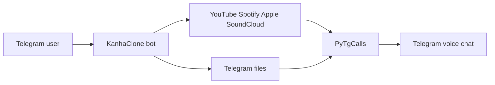
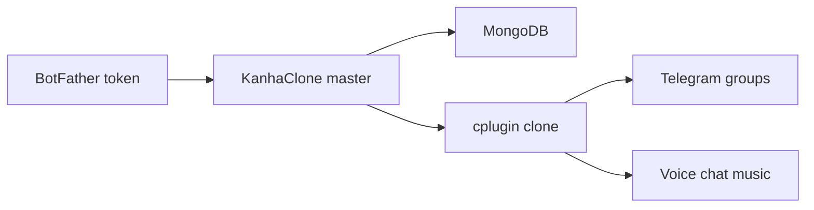

<div id="top"></div>

<p align="center">
  
</p>

<p align="center">
  
</p>

<p align="center">
  
</p>

<p align="center">
  <a href="https://telegram.org"></a>
  
  
  <a href="https://t.me/BotFather"></a>
  <a href="https://t.me/MeowClone"></a>
  <a href="./LICENSE"></a>
</p>

<p align="center">
  Stream songs into Telegram group and channel voice chats.<br/>
  Paste a BotFather token with <code>/clone</code> and mint your own Kanha music bot.
</p>

---

## What it is

KanhaClone is a Telegram music bot. One master bot plays audio and video in voice chats. The same process can run up to 500 cloned bots. Each clone is a normal Telegram bot that plays music in its own groups.

```text
Telegram user
    |  /play   /vplay   /clone
    v
KanhaClone  (Telegram bot)
    |-- Kanha music   ->  Telegram voice chat
    |-- YouTube / Spotify / Apple / SoundCloud / Telegram files
    |-- MongoDB       ->  clone tokens
    +-- cplugin       ->  cloned Telegram bots
```

---

## Telegram music

The bot joins the group voice chat with an assistant account and streams through PyTgCalls.

| Source | What plays |
|--------|------------|
| YouTube | Search, URL, playlist |
| Spotify | Track and playlist metadata |
| Apple Music | Track links |
| Resso | Track links |
| SoundCloud | Track links |
| Telegram | Replied audio, video, document |
| Live URL | Direct stream |

Queue controls: pause, resume, skip, stop, shuffle, loop, seek, speed. Video play with `/vplay`. Channel voice chat with `/cplay`.



---

## Kanha clone

Anyone can clone a personal music bot from the master.

1. Create a bot with [@BotFather](https://t.me/BotFather)
2. Copy the token
3. Send `/clone <token>` to KanhaClone
4. The clone starts in memory and is restored from Mongo on reboot

Cap is 500 clones. Never paste tokens in public chats.

```text
/clone <bot_token>
/mybot   /mybots
/delclone <token|@bot>
```

Owner / sudo:

```text
/cloned        /clonedinfo     /totalbots
/active        /inactive       /delinactive
/delallclone   /botstats
/addpremium    /removepremium  /premiumbots
```



---

## Features

| | |
|---|---|
| Telegram music | Audio and video in group and channel voice chats |
| Sources | YouTube, Spotify, Apple Music, Resso, SoundCloud, Telegram files, live URLs |
| Queue | Pause, resume, skip, stop, shuffle, loop, seek, speed |
| Kanha clone | `/clone`, `/mybots`, `/delclone` plus owner fleet tools |
| Group control | Auth users, playmode, language, settings, logger |
| Sudo | Global ban, chat blacklist, broadcast, maintenance, restart |

---

<details>
<summary><b>Playback commands</b></summary>
<br/>

| Command | Action |
|---------|--------|
| `/play` `/vplay` | Audio or video from query, URL, or replied Telegram file |
| `/playforce` `/vplayforce` | Skip the queue and play now |
| `/cplay` `/cvplay` | Play in a linked channel voice chat |
| `/pause` `/resume` | Pause or resume |
| `/skip` `/next` | Next track |
| `/stop` `/end` | Stop and clear the queue |
| `/loop` | Repeat the current track |
| `/shuffle` | Shuffle the queue |
| `/seek` `/seekback` | Jump forward or back |
| `/speed` `/slow` | Change playback speed |
| `/playmode` | Who can use play commands |

Channel prefix: `/cskip`, `/cpause`, `/cresume`, `/cend`.

</details>

<details>
<summary><b>Group, sudo, owner</b></summary>
<br/>

| Command | Action |
|---------|--------|
| `/start` `/help` | Menus |
| `/settings` | Chat settings |
| `/lang` | Language |
| `/ping` `/stats` | Latency and system stats |
| `/auth` `/unauth` `/authusers` | Non-admin playback access |
| `/reload` | Refresh admin cache |
| `/addsudo` `/delsudo` `/sudolist` | Sudo list |
| `/gban` `/ungban` `/gbanlist` | Global ban |
| `/blacklistchat` `/whitelistchat` | Chat blacklist |
| `/broadcast` | Message served chats and users |
| `/maintenance` | Global maintenance |
| `/logger` | Activity logs |
| `/restart` | Restart the process |

</details>

---

## Deploy

<p align="center">
  <a href="https://heroku.com/deploy?template=https://github.com/Kanha-Team/KanhaClone"></a>
  &nbsp;
  <a href="https://railway.app/new/template?template=https://github.com/Kanha-Team/KanhaClone"></a>
  &nbsp;
  <a href="https://render.com/deploy?repo=https://github.com/Kanha-Team/KanhaClone"></a>
</p>

### Requirements

| Need | Notes |
|------|-------|
| Python | 3.11 |
| Node.js | 20 (Py-TgCalls) |
| FFmpeg | Audio and video |
| MongoDB | Atlas free tier works |
| Telegram API | `API_ID` / `API_HASH` from [my.telegram.org](https://my.telegram.org) |
| Bot token | [@BotFather](https://t.me/BotFather) |
| String session | Pyrogram session of the assistant account that joins voice chats |

### Environment

Copy `sample.env` to `.env`. Never commit `.env` or session files.

| Variable | Required | Description |
|----------|:--------:|-------------|
| `API_ID` | yes | Telegram API ID |
| `API_HASH` | yes | Telegram API hash |
| `BOT_TOKEN` | yes | BotFather token |
| `STRING_SESSION` | yes | Assistant Pyrogram session |
| `MONGO_DB_URI` | yes | Mongo connection string (`MONGO_URI` is accepted too) |
| `LOGGER_ID` | yes | Log group ID (bot must be admin) |
| `OWNER_ID` | yes | Owner user ID |
| `STRING_SESSION2` | no | Second assistant |
| `SUPPORT_CHANNEL` `SUPPORT_CHAT` | no | Links shown in the bot |
| `DURATION_LIMIT` | no | Max track length |
| `SPOTIFY_CLIENT_ID` `SPOTIFY_CLIENT_SECRET` | no | Spotify metadata |
| `MEOW_API_URL` `MEOW_API_KEY` `MEOW_FALLBACK_API_URL` | no | Music API endpoints |
| `START_IMG_URL` | no | Start card image |

Full template with every supported variable is in `sample.env`.

### VPS

```bash
git clone https://github.com/Kanha-Team/KanhaClone KanhaClone
cd KanhaClone
```

```bash
apt update
apt install -y git curl ffmpeg python3-venv python3-pip
```

```bash
curl -fsSL https://deb.nodesource.com/setup_20.x | bash -
apt install -y nodejs
```

```bash
python3 -m venv venv
source venv/bin/activate
pip install -U uv
uv sync --frozen
cp sample.env .env
```

`uv sync --frozen` installs exactly what `uv.lock` pins and is the only
supported install path. If you edited `pyproject.toml`, run `uv lock` first,
then `uv sync`.

Edit `.env`, then:

```bash
bash start
```

`bash start` uses `venv/bin/python` automatically, so activating the venv is
optional. To keep it running after you close the SSH session:

```bash
nohup bash start > bot.log 2>&1 &
tail -f bot.log
```

### Docker

```bash
cd KanhaClone
cp sample.env .env
docker build -t kanhaclone .
docker run --env-file .env kanhaclone
```

The image includes Python 3.11, Node.js 20, and FFmpeg.

---

<details>
<summary><b>Layout</b></summary>
<br/>

```text
KanhaClone/
  KanhaClone/
    core/          Telegram bot, assistant, calls, mongo
    plugins/       master commands
    cplugin/       handlers for cloned Telegram bots
    platforms/     YouTube, Spotify, Apple, Resso, SoundCloud, Telegram
    utils/         database, stream, inline, thumbs
  strings/         language packs
  config.py
  sample.env
  pyproject.toml
  Dockerfile
  docker-compose.yml
  Procfile
  heroku.yml
  app.json
  runtime.txt
  start
  setup
  LICENSE
  COPYING
  CONTRIBUTING.md
  CODE_OF_CONDUCT.md
  SECURITY.md
```

</details>

<details>
<summary><b>Troubleshooting</b></summary>
<br/>

| Problem | Fix |
|---------|-----|
| `AttributeError: module 'pyrogram.raw.types' has no attribute 'InputFileStoryDocument'` | PyPI `pyrogram` got installed next to `kurigram` and overwrote its files. Fixed in `pyproject.toml`; reinstall with `uv sync --frozen` |
| `ModuleNotFoundError: No module named 'six'` | `heroku3` imports `six` without declaring it. `six` is pinned now; `uv sync --frozen` |
| `ModuleNotFoundError: No module named 'KanhaClone'` | You are not in the repo root or the venv is missing. Use `cd KanhaClone && bash start` |
| `MONGO_DB_URI is missing` | Fill it in `.env`. `MONGO_URI` is accepted as an alias |
| `NodeJSNotInstalled` | Install Node.js 20, restart |
| Joins but silent | FFmpeg installed, assistant in the Telegram group, voice chat on |
| Mongo error | Check `MONGO_DB_URI` and Atlas IP allowlist |
| Clone fails | Fresh BotFather token, not already cloned |
| Log group errors | Add the bot to `LOGGER_ID` and start that group's video chat once |

</details>

---

## License

KanhaClone is released under the **GNU v3.0 License Agreement**.

```text
Copyright (C) 2026 by Kanha-Team@Github, < https://github.com/Kanha-Team>.
This file is part of < https://github.com/Kanha-Team/KanhaClone > project,
and is released under the "GNU v3.0 License Agreement".
Please see < https://github.com/Kanha-Team/KanhaClone/blob/main/LICENSE >
All rights reserved.
```

Full text in [`LICENSE`](LICENSE), verbatim copy in [`COPYING`](COPYING).

## Support

- Support group: [MeowClone](https://t.me/MeowClone)
- Bot token: [@BotFather](https://t.me/BotFather)
